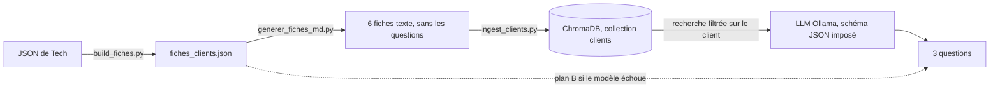
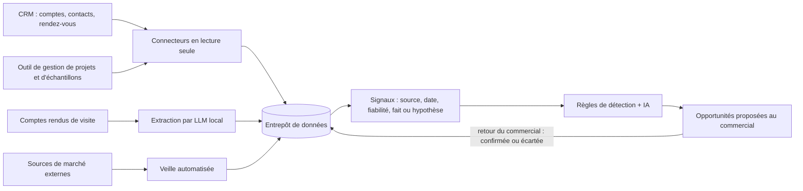

# Livrable Data – groupe G03 (Marvel)

**Givaudan AI Challenge 2026 · Défi 01 « La relation commerciale à l'ère de l'IA » · Livrable du jeudi 12/11/2026**
Équipe Data : Amir Meraka, Ossama Farhaoui et Evrad Marold Okoue Nfane. Document rédigé par Amir Meraka. **Toutes les données du prototype sont fictives.**

| Dépôt | Contenu |
|---|---|
| [Gr03-Marvels-MD4, branche `Amir`](https://github.com/Amir239278/Gr03-Marvels-MD4/tree/Amir) | API RAG (fork de `hmicn/example-rag`) : nom d'un client → 3 questions |
| [Data_intelligence, branche `amir`](https://github.com/Hetic-Hackathon-Givaudan-2026-Kevin/Data_intelligence/tree/amir) | API V1, fiches clients, prompt, documentation |
| [app-hackathon, branche `develop`](https://github.com/Hetic-Hackathon-Givaudan-2026-Kevin/app-hackathon/tree/develop) | Prototype de l'équipe Tech (Next.js) |

## 1. Le produit et le rôle de la Data

**Opportunity Radar** aide un commercial Givaudan à voir son portefeuille, à comprendre pourquoi une opportunité lui est proposée, et à préparer son rendez-vous.

La brique Data/IA fournit :
1. les **fiches clients** et leur modèle standard ;
2. une **API** qui, à partir du nom d'un client, génère **3 questions à poser avant le premier appel** ;
3. la **justification** des opportunités (faits et hypothèses séparés) et la structure du **compte rendu**.

## 2. Données

| Jeu de données | Volume | Origine |
|---|---|---|
| Jeu de démonstration de Tech | 12 clients, 27 projets, 18 opportunités, 18 signaux (10 faits, 8 hypothèses), 11 rendez-vous | Écrit par l'équipe, fictif |
| Fiches clients Data | 6 clients du secteur alimentaire et boissons, 15 projets, 12 opportunités, 12 signaux, 18 questions préparées | Dérivées du jeu de Tech par script |

- **Modèle standard de fiche** : identité, indicateurs, synthèse, projets, opportunités et signaux, historique, 3 questions préparatoires, points à confirmer (`fiches_clients/modele_fiche_client.json`).
- **Chaque signal** porte une source, une date, une fiabilité et une nature : **fait** ou **hypothèse**.
- **Contrôle de cohérence** : les indicateurs de chaque fiche (projets actifs, opportunités, opportunités à qualifier) sont recalculés et comparés aux compteurs du jeu de Tech. Le script échoue en cas d'écart.
- **Aucune donnée réelle** de Givaudan ou de ses clients. Les noms de marques connues présents dans le jeu de Tech sont utilisés à titre d'illustration.

## 3. Pipeline

| Étape | Script | Résultat |
|---|---|---|
| Construire les fiches | `fiches_clients/build_fiches.py` (dépôt Data_intelligence) | `fiches_clients.json`, compteurs vérifiés |
| Préparer le texte à ingérer | `fiches_clients/generer_fiches_md.py` | 6 fichiers `client_<id>.md`, **sans** les questions préparées |
| Ingérer | `ingest_clients.py` | 36 morceaux (6 sections par client), embeddings `nomic-embed-text` |
| Évaluer | `evaluer.py` | `docs/evaluation.md` |

Reproduction : voir « Démarrage rapide » dans le README du dépôt Gr03-Marvels-MD4.

## 4. Modèle

RAG local, sans entraînement. Aucune donnée ne sort du poste : les modèles tournent avec Ollama.

| Élément | Choix |
|---|---|
| Embeddings | `nomic-embed-text` |
| Base vectorielle | ChromaDB, distance cosinus, recherche **filtrée sur l'identifiant du client** |
| Génération | LLM Ollama (`qwen2.5:1.5b` par défaut, `gemma2:2b` en option), température 0,2 |
| Garde-fous | Schéma JSON imposé (3 questions, 6 catégories autorisées), lecture tolérante, rejet des questions au vocabulaire interne, plan B, champs `source` et `origine` |

**Versions**

| Version | Méthode | Constat |
|---|---|---|
| V1 | Prompt seul, données de l'opportunité dans le prompt, JSON libre | Mesuré le 12/11 sur une opportunité : 1 modèle sur 4 respecte le format (`gemma2:2b`, 69 s) ; `llama3.2:1b` (27 s), `qwen2.5:1.5b` (45 s) et `llama3.2:3b` (98 s) échouent |
| V2 | RAG sur les fiches clients + schéma JSON imposé à Ollama + lecture tolérante + contrôle du vocabulaire + plan B | Version en ligne. Sur 6 clients avec `qwen2.5:1.5b` : format respecté 5 fois sur 6 (V1 : 0 sur 6), 17 questions sur 18 retenues |

**Honnêteté du résultat** : chaque réponse indique sa `source` : `modele` (3 questions du LLM), `mixte` (questions du LLM complétées par des questions préparées) ou `simule` (3 questions préparées, si le modèle échoue ou dépasse le délai). Chaque question porte son `origine` : `modele` ou `prepare`.

## 5. Métriques et protocole sur 30 cas

Protocole automatisé par `python evaluer.py` (dépôt Gr03-Marvels-MD4), rapport dans `docs/evaluation.md`.

| Famille | Cas | Critère de réussite |
|---|---|---|
| Recherche | 12 (une requête par opportunité) | La fiche du bon client arrive en première position |
| Nom du client | 12 (6 noms approximatifs, 6 noms à refuser) | Bon client reconnu ; nom inconnu ou ambigu refusé |
| Génération | 6 (un par client) | 3 questions du modèle valides (bon format, sans vocabulaire interne), sans nom d'un autre client, au moins une question ancrée dans la fiche |

Le script compare aussi V1 et V2 sur le respect du format et la durée.

### Résultats (12/11/2026, 21 h 35, `qwen2.5:1.5b`) : 29 cas réussis sur 30

| Famille | Réussis | Détail |
|---|---|---|
| Recherche | 12/12 | Bon client en première position à chaque fois |
| Nom du client | 12/12 | 6 noms approximatifs reconnus, 6 noms refusés |
| Génération V2 | 5/6 | 17 questions sur 18 retenues. Cas échoué : Alimenta Distribution, une question écartée par le contrôle et remplacée par une question préparée (`source: mixte`) |

| Version | Méthode | Format respecté | Durée médiane |
|---|---|---|---|
| V1 | Prompt seul, JSON libre, lecture stricte | 0/6 | 16 s |
| V2 | Schéma JSON imposé + lecture tolérante | 5/6 | 34 s (maximum 50 s) |

**Lecture** : la V2 double le temps de réponse, mais elle rend le résultat exploitable : sans schéma imposé, aucune réponse du modèle n'était utilisable par l'API.

**Lecture qualitative des 17 questions** (première lecture par l'équipe Data, qui n'est pas experte du métier) : environ 9 sont utilisables, 6 sont à reformuler (formulation générique ou fautes d'accord) et 2 sont à écarter. Exemple à écarter : pour Danone, le modèle demande « la date de début de la production » d'un produit végétal, alors que la fiche ne parle que d'un intérêt exploratoire. Les questions complètes sont dans `docs/evaluation.md`.

**Conclusion** : la forme est maîtrisée, la pertinence reste limitée par la taille du modèle. Pour la démonstration, les questions préparées et relues restent la référence ; la génération en direct montre la faisabilité. Pistes : tester un modèle plus grand avec le même script (`python evaluer.py --model gemma2:2b`), ajouter des exemples de bonnes questions dans le prompt.

**Tests automatiques** : 16 tests sur l'API RAG, 12 tests sur l'API V1. Ils passent sans Ollama.

**Limites du protocole** : cas écrits par l'équipe sur 6 clients fictifs ; la recherche est un cas facile (6 clients, requête égale à l'intitulé de l'opportunité) ; une seule exécution par cas ; « ancrée » et « sans fuite » sont des contrôles par mots-clés ; la pertinence des questions doit être relue par un commercial senior, ce qui n'a pas encore été fait.

## 6. API

Service FastAPI, Swagger sur `/docs`.

| Méthode | Route | Rôle |
|---|---|---|
| POST | `/questions-client` | `{"client": "PepsiCo"}` → 3 questions `{question, objectif, information_recherchee, origine}`, `source`, `model`, `duree_s`, extraits de la fiche utilisés |
| GET | `/questions-client/{client}` | Même résultat, nom dans l'adresse |
| GET | `/clients` | Clients disponibles |
| GET | `/health` | État de la base et modèles utilisés |

Accès temporaire par ngrok : `https://vowel-paramount-lisp.ngrok-free.dev` (disponible seulement quand le poste de l'équipe Data est allumé).

**Exemple réel** (12/11/2026, 21 h 09, appel par ngrok, `qwen2.5:1.5b`, 48,5 s, `source: modele`), client PepsiCo :

| Question générée par le modèle | Verdict de l'équipe |
|---|---|
| Quel est le niveau de réduction attendu pour les snacks à teneur réduite en sel ? | Utilisable : l'information manque dans la fiche |
| Quels sont les objectifs de réduction de sucre que vous avez évoqués lors du dernier échange ? | Utilisable, à reformuler : l'objectif chiffré reste à obtenir |
| Quelles sont les deux opportunités à qualifier qui ont été détectées lors de la dernière mise à jour ? | **Inutilisable** : vocabulaire interne, question impossible à poser à un client |

Ce test a conduit à ajouter un garde-fou : une question qui emploie le vocabulaire interne est écartée et remplacée par une question préparée (`source: mixte`).

L'API V1 (dépôt Data_intelligence) fournit aussi `GET /justification/{opportunity_id}` et `POST /compte-rendu`.

## 7. Intégration avec Tech

| Élément | État au 12/11 |
|---|---|
| Jeu de données commun | Fait : les fiches Data sont dérivées du JSON de Tech, mêmes identifiants |
| Écrans portefeuille, détail d'une opportunité, préparation du rendez-vous | Faits par Tech, alimentés par des fichiers JSON statiques |
| Appel de l'API Data depuis l'écran | **À faire** : l'API est en ligne et documentée, le branchement reste à réaliser |

## 8. Passage à l'échelle : comment accéder aux données réelles

Réponse à la remarque du jury : comment obtenir les données sur les clients, les projets et le marché pour générer les opportunités. **Ceci est une proposition. Rien n'est connecté aujourd'hui, et les systèmes réels de Givaudan sont à confirmer avec ses équipes informatiques.**

| Donnée | Source envisagée | Mode d'accès | Fréquence |
|---|---|---|---|
| Clients, contacts, historique commercial | CRM de Givaudan | API du CRM ou export planifié, compte de service en lecture seule | Quotidienne |
| Projets, échantillons, retours techniques | Outil interne de gestion de projets | Export ou vue dédiée dans l'entrepôt de données | Quotidienne |
| Comptes rendus de visite (texte libre) | CRM ou messagerie interne | Extraction par un LLM hébergé en interne : besoins, contraintes, calendrier | À chaque nouveau compte rendu |
| Lancements de produits des clients | Bases ouvertes (par exemple Open Food Facts), sites des marques | API publique, collecte hebdomadaire | Hebdomadaire |
| Tendances de consommation | Études de marché sous licence, presse spécialisée, tendances de recherche | Abonnements, flux RSS | Hebdomadaire |
| Réglementation (sucre, sel, étiquetage) | Publications officielles (autorités sanitaires, Journal officiel de l'UE) | Veille sur les publications | À chaque publication |

**De la donnée à l'opportunité**
1. Chaque information devient un **signal** au même format que dans le prototype : description, source, date, fiabilité, fait ou hypothèse.
2. Des **règles simples et explicables** rapprochent les signaux. Exemple : un besoin exprimé par le client (fait) et une tendance de marché (hypothèse) donnent une opportunité « à qualifier ».
3. L'IA **rédige** la justification et les questions. Elle ne décide pas seule : le commercial confirme ou écarte, et ce retour améliore les règles.

**Conditions à respecter**
- **Confidentialité** : LLM hébergé chez Givaudan, aucune donnée client envoyée à un service externe.
- **Droits d'accès** : un commercial ne voit que son portefeuille, comme dans le CRM.
- **RGPD** : seules les données utiles sont collectées ; les données personnelles des contacts ne sont pas envoyées au modèle.
- **Qualité** : une opportunité sans signal daté et sourcé n'est jamais proposée.

**Déploiement progressif** : (1) export quotidien du CRM pour un portefeuille pilote ; (2) connexion par API et ajout des projets ; (3) veille de marché externe ; (4) mesure : part des opportunités confirmées par les commerciaux.

## 9. Limites

- Données fictives : le prototype ne prouve pas la valeur sur des données réelles.
- Petits modèles locaux sur un poste sans carte graphique : réponse en 30 à 100 secondes, qualité variable. Le plan B garantit une réponse.
- L'API est hébergée sur le poste de l'équipe : pas de disponibilité continue.
- Les questions n'ont pas encore été validées par un commercial senior.
- L'écran de Tech n'appelle pas encore l'API en direct.

## 10. Récapitulatif des livrables

| Livrable attendu | Preuve |
|---|---|
| Données nettoyées et préparées | `fiches_clients/fiches_clients.json`, `modele_fiche_client.json`, `client_*.md` |
| Pipeline fonctionnel | `build_fiches.py`, `generer_fiches_md.py`, `ingest_clients.py` |
| Modèle V2 publié | `clients.py` (RAG + schéma imposé), dépôt Gr03-Marvels-MD4 |
| Métriques et protocole sur 30 cas | `evaluer.py`, `docs/evaluation.md` |
| API fonctionnelle | `api.py`, Swagger `/docs`, adresse ngrok |
| Prompt destiné à l'IA | `fiches_clients/prompt_fiche_client.md`, prompt système dans `clients.py` |
