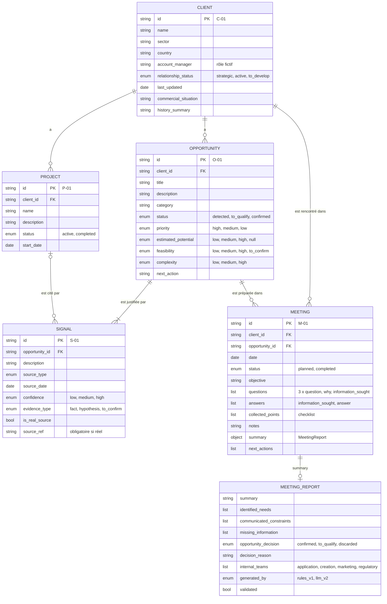

# Modèle de données — démo v2

Dictionnaire de données et schéma relationnel du jeu de démo de Givaudan
Opportunity Radar (doc fonctionnelle v2, section 8), établis à partir des
fichiers réels de `data/demo_v2/`. Ticket DATA-US02.

Toutes les données sont fictives, sauf les signaux marqués `is_real_source`.

## Conventions

- **Fichiers** : un fichier JSON par entité stockée, contenant une liste
  d'objets (`clients.json`, `projects.json`, `opportunities.json`,
  `signals.json`, `meetings.json`). `MeetingReport` n'a pas de fichier : il est
  rangé dans `Meeting.summary`.
- **Clés** en anglais, `snake_case` ; valeurs d'énumération en anglais (codes),
  les libellés français étant affichés par l'app.
- **Obligatoire** : `oui` = la clé est présente dans chaque objet. Une clé
  obligatoire peut valoir `null` ou une liste vide quand la colonne « Valeurs
  possibles » le précise.
- **Types** : `string`, `enum` (liste fermée), `date` (AAAA-MM-JJ),
  `bool`, `liste de …`, `objet`, `null`.
- **Champs « extension »** : absents de la structure minimale de la section 8,
  ajoutés pour la démo.

### Format des identifiants

| Entité | Format | Exemple |
| --- | --- | --- |
| Client | `C-` + 2 chiffres | `C-01` |
| Project | `P-` + 2 chiffres | `P-01` |
| Opportunity | `O-` + 2 chiffres | `O-01` |
| Signal | `S-` + 2 chiffres | `S-01` |
| Meeting | `M-` + 2 chiffres | `M-01` |

`MeetingReport` n'a pas d'identifiant propre : il appartient à son `Meeting`.

## Entités

### Client

Fichier `clients.json`. Un client du portefeuille.

| Champ | Type | Obligatoire | Valeurs possibles | Description | Exemple |
| --- | --- | --- | --- | --- | --- |
| `id` | string | oui | `C-\d{2}`, unique | Identifiant | `C-01` |
| `name` | string | oui | texte | Nom (fictif) de l'entreprise | `Maison Nova Drinks` |
| `sector` | string | oui | texte | Secteur d'activité | `Boissons` |
| `country` | string | oui | texte, en français | Pays | `France` |
| `account_manager` | string | oui | texte, rôle fictif, jamais un nom de personne | Responsable commercial | `KAM senior Boissons (fictif)` |
| `relationship_status` | enum | oui | `strategic`, `active`, `to_develop` | Statut de la relation | `strategic` |
| `last_updated` | date | oui | AAAA-MM-JJ | Dernière mise à jour des informations | `2026-11-05` |
| `commercial_situation` | string | oui | 2 phrases au plus | Situation commerciale (extension) | `Client établi en croissance, …` |
| `history_summary` | string | oui | 2 à 3 phrases | Résumé de l'historique (extension) | `Partenaire de longue date …` |

### Project

Fichier `projects.json`. Un travail **déjà engagé** avec le client (à
distinguer d'une opportunité, besoin pas encore engagé).

| Champ | Type | Obligatoire | Valeurs possibles | Description | Exemple |
| --- | --- | --- | --- | --- | --- |
| `id` | string | oui | `P-\d{2}`, unique | Identifiant | `P-01` |
| `client_id` | string | oui | `id` d'un Client | Client du projet | `C-01` |
| `name` | string | oui | texte, sans vrai nom de produit ni de marque | Nom du projet | `Reformulation de l'arôme agrumes de la gamme existante` |
| `description` | string | oui | texte | Description courte | `Travail en cours sur la gamme …` |
| `status` | enum | oui | `active`, `completed` | Statut | `active` |
| `start_date` | date | oui | AAAA-MM-JJ, ≤ `last_updated` du client | Date de début | `2026-10-10` |

### Opportunity

Fichier `opportunities.json`. Un besoin potentiel, pas encore engagé.

| Champ | Type | Obligatoire | Valeurs possibles | Description | Exemple |
| --- | --- | --- | --- | --- | --- |
| `id` | string | oui | `O-\d{2}`, unique | Identifiant | `O-01` |
| `client_id` | string | oui | `id` d'un Client | Client concerné | `C-01` |
| `title` | string | oui | texte | Intitulé | `Nouvelle gamme de boissons fonctionnelles` |
| `description` | string | oui | texte | Explication brève | `Le client s'intéresse à …` |
| `category` | string | oui | texte ; dans la démo : `Nouvelle gamme`, `Extension de gamme`, `Nouvelle formulation`, `Amélioration produit`, `Optimisation`, `Nouvelle référence` | Catégorie | `Nouvelle gamme` |
| `status` | enum | oui | `detected`, `to_qualify`, `confirmed` | Détectée, à qualifier, confirmée (section 4.3) | `to_qualify` |
| `priority` | enum | oui | `high`, `medium`, `low` | Priorité, calculée à la génération par la règle de `README.md` (section 5.3) puis stockée | `high` |
| `estimated_potential` | enum | oui | `low`, `medium`, `high` ou `null` (non renseigné) | Potentiel indicatif, **jamais un montant** | `high` |
| `feasibility` | enum | oui | `low`, `medium`, `high`, `to_confirm` | Faisabilité | `to_confirm` |
| `complexity` | enum | oui | `low`, `medium`, `high` | Complexité technique | `high` |
| `next_action` | string | oui | texte actionnable | Recommandation | `Organiser un échange avec le client …` |

### Signal

Fichier `signals.json`. Une information qui justifie une opportunité
(section 5.1).

| Champ | Type | Obligatoire | Valeurs possibles | Description | Exemple |
| --- | --- | --- | --- | --- | --- |
| `id` | string | oui | `S-\d{2}`, unique | Identifiant | `S-01` |
| `opportunity_id` | string | oui | `id` d'une Opportunity | Opportunité justifiée | `O-01` |
| `description` | string | oui | texte | Ce que dit le signal | `Compte rendu de l'échange commercial du 05/11/2026 : …` |
| `source_type` | enum | oui | `meeting_report`, `project_history`, `client_request`, `market_trend`, `commodity_price`, `company_report`, `regulation` | Type de source | `meeting_report` |
| `source_date` | date | oui | AAAA-MM-JJ ; pour une tendance, fin de la période observée | Date de l'information | `2026-11-05` |
| `confidence` | enum | oui | `low`, `medium`, `high` | Niveau de fiabilité | `high` |
| `evidence_type` | enum | oui | `fact`, `hypothesis`, `to_confirm` | Fait, hypothèse ou à confirmer (section 5.5) | `fact` |
| `is_real_source` | bool | oui | `true`, `false` | Source réelle (extension) | `false` |
| `source_ref` | string | oui | URL ou fichier ; `null` autorisé seulement si `is_real_source` vaut `false` | Référence de la source (extension) | `data/signaux/signaux_marche.json#OPP-01 (…)` |

### Meeting

Fichier `meetings.json` (pas encore créé). Un rendez-vous commercial préparé
avec le Meeting Copilot (section 4.4).

| Champ | Type | Obligatoire | Valeurs possibles | Description | Exemple |
| --- | --- | --- | --- | --- | --- |
| `id` | string | oui | `M-\d{2}`, unique | Identifiant | `M-01` |
| `client_id` | string | oui | `id` d'un Client, le même que celui de l'opportunité | Client rencontré | `C-01` |
| `opportunity_id` | string | oui | `id` d'une Opportunity | Opportunité concernée | `O-01` |
| `date` | date | oui | AAAA-MM-JJ | Date du rendez-vous (extension) | `2026-11-18` |
| `status` | enum | oui | `planned`, `completed` | Statut (extension) | `planned` |
| `objective` | string | oui | texte | Objectif du rendez-vous | `Comprendre les intentions du client …` |
| `questions` | liste d'objets | oui | 3 objets `{question, why, information_sought}` (voir ci-dessous) | Questions suggérées | `[{"question": "…", "why": "…", "information_sought": "timeline"}]` |
| `answers` | liste d'objets | oui | objets `{information_sought, answer}` (voir ci-dessous) ; liste vide si `planned` | Réponses obtenues, chacune reliée à un point de la checklist | `[{"information_sought": "timeline", "answer": "Premier test au printemps."}]` |
| `collected_points` | liste d'enum | oui | parmi `client_objectives`, `real_need`, `technical_constraints`, `budget_constraints`, `timeline`, `decision_criteria` ; liste vide si `planned` | Points cochés de la checklist (extension) | `["client_objectives", "timeline"]` |
| `notes` | string | oui | texte libre ; chaîne vide si `planned` | Notes du rendez-vous | `Lancement visé au printemps.` |
| `summary` | objet MeetingReport | oui | objet MeetingReport, ou `null` tant que le compte rendu n'est pas généré | Compte rendu | voir MeetingReport |
| `next_actions` | liste de string | oui | liste vide si `planned` | Prochaines actions recommandées (seul endroit où elles sont stockées) | `["Obtenir le budget visé."]` |

Objet `questions[]` :

| Champ | Type | Valeurs possibles | Description |
| --- | --- | --- | --- |
| `question` | string | question ouverte | La question à poser |
| `why` | string | texte | Pourquoi elle est importante |
| `information_sought` | enum | un des 6 points de la checklist, encore manquant | L'information recherchée |

Objet `answers[]` :

| Champ | Type | Valeurs possibles | Description |
| --- | --- | --- | --- |
| `information_sought` | enum | un des 6 points de la checklist | Le point auquel la réponse se rapporte |
| `answer` | string | texte | La réponse obtenue |

Les trois champs se répondent : un point qui a une réponse dans `answers`
figure dans `collected_points` ; un point absent de `collected_points` figure
dans `summary.missing_information`.

### MeetingReport

Contenu de `Meeting.summary` : le compte rendu du rendez-vous (section 4.4 F).
Les prochaines actions n'y sont pas répétées : elles restent dans
`Meeting.next_actions`.

| Champ | Type | Obligatoire | Valeurs possibles | Description | Exemple |
| --- | --- | --- | --- | --- | --- |
| `summary` | string | oui | texte | Résumé du rendez-vous | `Rendez-vous avec Maison Nova Drinks au sujet de …` |
| `identified_needs` | liste de string | oui | liste, éventuellement vide | Besoins identifiés | `["Objectifs du client : …"]` |
| `communicated_constraints` | liste de string | oui | liste, éventuellement vide | Contraintes communiquées | `["Contraintes techniques : …"]` |
| `missing_information` | liste de string | oui | libellés des points de la checklist non recueillis | Informations encore manquantes | `["Calendrier"]` |
| `opportunity_decision` | enum | oui | `confirmed`, `to_qualify`, `discarded` (mêmes noms que `Opportunity.status` ; `discarded` = « écartée », prévu par la doc pour plus tard) | Statut proposé pour l'opportunité après le rendez-vous | `to_qualify` |
| `decision_reason` | string | oui | texte | Raison de la décision | `Le besoin réel n'a pas été recueilli.` |
| `internal_teams` | liste d'enum | oui | parmi `application`, `creation`, `marketing`, `regulatory` (équipes de la section 2.4 ; libellés français dans l'app) ; liste éventuellement vide | Équipes internes potentiellement concernées | `["application"]` |
| `generated_by` | enum | oui | `rules_v1` (modèle de texte), `llm_v2` | Mode de génération | `rules_v1` |
| `validated` | bool | oui | `true`, `false` | Validé par le commercial | `false` |

## Champs calculés, jamais stockés

Ils se calculent à partir des fichiers à chaque lecture, pour ne jamais se
contredire :

| Champ | Portée | Calcul |
| --- | --- | --- |
| `active_projects` | Client | nombre de projets du client dont `status` vaut `active` |
| `detected_opportunities` | Client | nombre d'opportunités du client, **quel que soit leur statut** |
| `to_qualify` | Client | nombre d'opportunités du client dont `status` vaut `to_qualify` |
| `last_signal_date` | Opportunity | plus grande `source_date` des signaux de l'opportunité |
| `followed_clients` | Tableau de bord | nombre de clients |
| `detected_opportunities` | Tableau de bord | nombre total d'opportunités |
| `to_qualify` | Tableau de bord | nombre total d'opportunités `to_qualify` |
| `meetings_to_prepare` | Tableau de bord | nombre de rendez-vous `planned` (0 sans `meetings.json`) |

Dans la démo : Maison Nova Drinks a 3 projets actifs, 2 opportunités détectées
et 1 à qualifier ; Nordic Food Industries 2, 3 et 1 ; Alimenta Distribution 1,
1 et 0.

## Relations

| Relation | Cardinalité | Clé |
| --- | --- | --- |
| Client → Project | un client a 0..n projets ; un projet a 1 client | `Project.client_id` |
| Client → Opportunity | un client a 0..n opportunités ; une opportunité a 1 client | `Opportunity.client_id` |
| Opportunity → Signal | une opportunité a **1..n** signaux ; un signal a 1 opportunité | `Signal.opportunity_id` |
| Client → Meeting | un client a 0..n rendez-vous ; un rendez-vous a 1 client | `Meeting.client_id` |
| Opportunity → Meeting | une opportunité a 0..n rendez-vous ; un rendez-vous a 1 opportunité | `Meeting.opportunity_id` |
| Meeting → MeetingReport | un rendez-vous a 0..1 compte rendu (inclus) | `Meeting.summary` |
| Project → Signal | un projet est cité par 0..n signaux ; un signal cite 0..1 projet | `Signal.source_ref` (`data/demo_v2/projects.json#P-01`) |

## Règles

1. **Identifiants uniques** dans chaque fichier, au format ci-dessus ; chaque
   clé étrangère (`client_id`, `opportunity_id`) pointe un objet existant, et
   `Meeting.client_id` est celui de l'opportunité du rendez-vous.
2. **Dates ISO** AAAA-MM-JJ, fixes (elles ne se décalent pas avec le temps) ;
   la date de référence du jeu est le 2026-11-12.
3. **Pas de montant en euros** : `estimated_potential` est un niveau
   indicatif ; aucune estimation fictive n'est présentée comme un montant
   commercial réel (section 4.3).
4. **Signaux réels sourcés** : si `is_real_source` vaut `true`, `source_ref`
   est obligatoire (URL ou fichier, avec page si besoin).
5. **Fait, hypothèse, à confirmer** (section 5.5) : `evidence_type` vaut
   `fact` si l'information est présente dans une source, `hypothesis` si c'est
   une interprétation, `to_confirm` si elle manque ou est incertaine.
6. **Une opportunité a au moins un signal** (section 5.1).
7. **Aucun compteur stocké** : voir « Champs calculés, jamais stockés ».
8. **Aucune donnée personnelle** : pas de nom de personne ; clients fictifs,
   sans lien avec de vrais clients de Givaudan.
