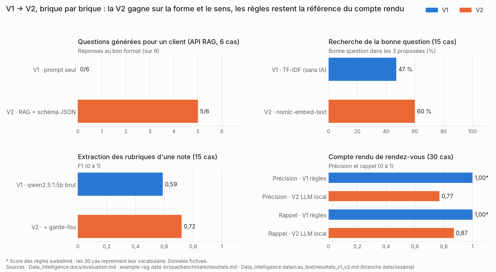

# Comparaison V1 / V2 et métriques – équipe Data G03

**Givaudan AI Challenge 2026 · Défi 01 « La relation commerciale à l'ère de l'IA » · Livrable Data du vendredi 13/11/2026, point 3**
Équipe Data : Amir Meraka, Ossama Farhaoui, Evrad Marold Okoue Nfane. **Toutes les données sont fictives.** Tous les modèles tournent en local (Ollama), sans appel à un service externe.

**En bref.** La V2 apporte un gain net là où l'IA travaille sur la forme ou le sens du texte : le format des questions générées passe de 0/6 à 5/6, et la bonne question arrive dans les 3 proposées 60 % des fois au lieu de 47 %. Pour le compte rendu, les règles (V1) restent le mode par défaut : le LLM local n'invente rien en sortie grâce au garde-fou, mais il se trompe plus souvent d'attribution et met 43 s par cas.

## Vue d'ensemble

| Brique | V1 | V2 | Métrique principale | V1 → V2 | Décision |
|---|---|---|---|---|---|
| Choix des 3 questions (banque de 24) | Référence : trame générique | Moteur de score | Rubriques du brief remplies par les 3 questions (sur 3) | 1,17 → **2,39** (hasard : 1,82) | Moteur retenu |
| Recherche de la bonne question | TF-IDF, sans IA | `nomic-embed-text` | Bonne question dans les 3 proposées | 47 % → **60 %** | V2, TF-IDF en repli |
| Questions générées pour un client (API RAG) | Prompt seul, JSON libre | RAG + schéma JSON imposé | Réponses au bon format | 0/6 → **5/6** | V2 (34 s au lieu de 16 s) |
| Extraction des rubriques d'une note | `qwen2.5:1.5b` brut | Même modèle + garde-fou | F1 | 0,59 → **0,72** | Pré-remplissage seulement |
| Compte rendu de rendez-vous | Règles (`rules_v1`) | `qwen2.5:3b` local + garde-fou (`llm_v2`) | Précision / rappel | 1,00 / 1,00 → 0,77 / 0,87 | **V1 par défaut**, V2 en option |

## 1. Choix des 3 questions : de la trame générique au moteur de score

**Protocole.** 90 comptes rendus fictifs générés avec une graine fixe (42), 469 questions posées. Le moteur apprend sur 62 comptes rendus et il est testé sur les 28 gardés de côté. Pour les mêmes rubriques vides, on compte combien de rubriques les 3 questions proposées permettent de remplir.

| Méthode | Rubriques remplies (sur 3) | Taux de réussite des questions proposées |
|---|---|---|
| Trame générique | 1,17 | 41 % (51 fois posées) |
| Hasard | 1,82 | – |
| **Moteur de score** | **2,39** (+104 % par rapport à la trame, +31 % par rapport au hasard) | **90 %** pour la question classée n° 1 (48 fois posées) |

**Limite.** Les comptes rendus sont simulés : ce résultat prouve que la chaîne fonctionne, pas que ces questions marchent avec de vrais clients.

## 2. Recherche de la bonne question : TF-IDF → embeddings (15 cas)

Le commercial écrit son besoin avec ses mots (« je ne sais pas quand ils lancent ») et l'outil doit retrouver la bonne question de la banque. Les 15 cas ont été écrits avant le premier essai, avec d'autres mots que ceux des questions.

| Mesure | V1 · TF-IDF | V2 · `nomic-embed-text` |
|---|---|---|
| Bonne rubrique au rang 1 | 40 % | **53 %** |
| Bonne question au rang 1 | 33 % (5/15) | **47 %** (7/15) |
| Bonne question dans le top 3 | 47 % (7/15) | **60 %** (9/15) |
| Bonne question dans le top 5 | 53 % | **73 %** |
| MRR | 0,44 | **0,56** |
| Temps par requête | **0,1 ms** | 70 à 120 ms |

**Lecture.** Les embeddings comprennent le sens : « haut de gamme » retrouve la question sur le public « premium » sans mot commun. Ils se trompent aussi sur un piège de vocabulaire (« magasin »), d'où le TF-IDF gardé en repli.
**Limite.** Avec 15 cas, un cas vaut 6,7 points : l'écart de 13 points sur le top 3 est encourageant, mais pas significatif.

## 3. Questions générées pour un client : prompt seul → RAG + schéma imposé (API RAG)

**Protocole.** 30 cas automatisés par `evaluer.py` : 12 de recherche (la fiche du bon client arrive en 1re position), 12 de reconnaissance du nom (6 noms approximatifs à reconnaître, 6 à refuser), 6 de génération (3 questions valides, sans vocabulaire interne, sans nom d'un autre client, au moins une question ancrée dans la fiche). Modèle `qwen2.5:1.5b`, embeddings `nomic-embed-text`.

| Version | Méthode | Réponses au bon format | Durée médiane |
|---|---|---|---|
| V1 | Prompt seul, JSON libre, lecture stricte | 0/6 | **16 s** |
| **V2** | RAG sur la fiche du client + schéma JSON imposé + lecture tolérante | **5/6** | 34 s (maximum 50 s) |

Résultat global de la V2 : **29/30** (recherche 12/12, nom du client 12/12, génération 5/6) ; 17 questions du modèle retenues sur 18.
**Lecture.** La V2 double le temps de réponse, mais sans schéma imposé aucune réponse n'était exploitable par l'API. Sur le fond, à la relecture par l'équipe, environ 9 questions sur 17 sont utilisables telles quelles, 6 sont à reformuler et 2 à écarter.
**Limite.** 6 cas de génération, une seule exécution par cas, contrôles par mots-clés, pas encore de relecture par un commercial senior.

## 4. Extraction des rubriques d'une note : modèle brut → garde-fou (15 notes)

Le modèle lit la note du rendez-vous précédent et dit quelles rubriques du brief sont déjà connues. Le garde-fou est une règle simple, sans IA : une rubrique ne compte que si sa valeur est non vide et si ses mots se retrouvent dans la note.

| Mesure (`qwen2.5:1.5b`) | V1 · brut | V2 · avec garde-fou |
|---|---|---|
| JSON valide | 100 % | 100 % |
| F1 | 0,59 (précision 0,44, rappel 0,92) | **0,72** |
| Notes avec une rubrique inventée | 100 % | 87 % |
| Temps par note | 11,4 s en moyenne, 17,9 s au maximum | identique (le garde-fou est une règle sans IA) |

**Décision.** Le modèle invente encore une rubrique dans 87 % des notes : son résultat ne sert qu'à **pré-remplir**, et le commercial confirme en un clic.
**Limite.** Le garde-fou a été conçu après avoir vu ces résultats ; il a ensuite été appliqué au compte rendu sur des cas nouveaux (section 5). Les mesures de `bge-m3` et `qwen2.5:3b`, faites plus tard sur un autre poste, sont sur la branche [`feature/data-benchmark`](https://github.com/Hetic-Hackathon-Givaudan-2026-Kevin/example-rag/tree/feature/data-benchmark) du dépôt [example-rag](https://github.com/Hetic-Hackathon-Givaudan-2026-Kevin/example-rag).

## 5. Compte rendu de rendez-vous : règles → LLM local (30 cas)

**Protocole.** 30 notes de rendez-vous fictives, générées avec une graine fixe, chacune avec sa vérité terrain (ce qui doit sortir, et avec quel statut). Les deux versions traitent les mêmes 30 cas. La V2 utilise `qwen2.5:3b` via Ollama : sortie JSON validée, puis garde-fou (un élément introuvable dans les notes passe en « à vérifier » ou est écarté), retour automatique aux règles si le modèle échoue, délai maximal de 120 s. Le moteur n'a pas été réglé sur ces cas.

| Rubrique | Précision V1 | Rappel V1 | Précision V2 | Rappel V2 |
|---|---|---|---|---|
| Besoins | 1,00 | 1,00 | 0,70 | 0,83 |
| Contraintes techniques | 1,00 | 1,00 | 0,78 | 0,95 |
| Contraintes budgétaires | 1,00 | 1,00 | 0,85 | 0,94 |
| Calendrier | 1,00 | 1,00 | 0,90 | 0,85 |
| Informations manquantes | 1,00 | 1,00 | 0,74 | 0,58 |
| **Total** | **1,00** | **1,00** | **0,77** | **0,87** |

| Indicateur | V1 · `rules_v1` | V2 · `llm_v2` |
|---|---|---|
| Extraits inventés avant le garde-fou | 0 | 25 sur 151 (17 %), tous écartés |
| Extraits inventés dans la sortie finale | 0 | **0** |
| Éléments rangés sur un point absent de la vérité terrain | 0 | 29 sur 126 (23 %) |
| Notes hors sujet remplies quand même (sur 5) | 0 | 2 |
| Statut juste (confirmé / à vérifier) | 111/111 | 93/97 (0,96) |
| Retours aux règles / dépassements du délai | – | 0 / 0 |
| Temps moyen par cas | moins de 0,01 s | 43 s (de 14 à 76 s) |

**Lecture.** Le sans-faute des règles est surestimé : le générateur des cas reprend leur vocabulaire. Le LLM n'invente rien en sortie, mais il range mal certaines phrases (surtout entre objectifs et besoin réel), oublie souvent les critères de décision (8 fois) et se trompe davantage sur les notes en anglais (12 des 17 cas où les points trouvés diffèrent de la vérité terrain). Sur 2 notes hors sujet, il colle la même phrase sur tous les points, marqués « confirmés » : le garde-fou ne le détecte pas, car la phrase existe bien dans la note.
**Décision.** `rules_v1` reste le mode par défaut ; `llm_v2` est une option expérimentale.
**Prochaine étape.** Tester la règle « un même extrait sur plus de 2 points passe en à vérifier » sur de nouveaux cas, rédigés par des humains, et non sur ces 30.

## Limites et biais communs

- **Données fictives**, écrites par l'équipe : les mêmes personnes ont rédigé les données et les cas de test, d'où un risque de biais de formulation.
- **Petits échantillons** (6, 15, 28 et 30 cas) et une seule exécution par cas : les écarts de quelques points ne sont pas significatifs.
- **Petits modèles sur un PC sans carte graphique**, avec peu de mémoire libre : les temps sont des ordres de grandeur.
- **Aucune validation métier** : aucun commercial n'a encore relu les questions ni les comptes rendus.
- **Règles suivies partout** : cas de test écrits avant de régler les prompts, graine 42, température basse, aucun appel externe.

## Reproduire

| Brique | Commande | Ollama nécessaire |
|---|---|---|
| Choix des 3 questions | `cd data-brique` puis `python scripts/generer_donnees.py` et `python scripts/premier_resultat.py` ([example-rag, `data-brique/scripts`](https://github.com/Hetic-Hackathon-Givaudan-2026-Kevin/example-rag/tree/main/data-brique/scripts)) | Non. Rejoué le 13/11/2026 : fichiers identiques |
| Recherche et extraction | `python benchmark/run_benchmark.py --rapport` régénère les tableaux ; `python benchmark/run_benchmark.py --pc <nom>` relance les mesures ([example-rag, `data-brique/benchmark/run_benchmark.py`](https://github.com/Hetic-Hackathon-Givaudan-2026-Kevin/example-rag/blob/main/data-brique/benchmark/run_benchmark.py)) | Non pour `--rapport` (rejoué le 13/11/2026 : identique), oui pour les mesures |
| Questions générées (API RAG) | `python evaluer.py` ([Gr03-Marvels-MD4, branche `Amir`](https://github.com/Amir239278/Gr03-Marvels-MD4/blob/Amir/evaluer.py), environ 10 minutes) | Oui |
| Compte rendu | `python data/cas_test/evaluer_v1_v2.py` ; l'option `--md-seulement` réécrit le rapport depuis le JSON sans relancer le LLM (dépôt Data_intelligence) | Oui, sauf avec `--md-seulement` |

## Sources

- [`docs/evaluation.md`](evaluation.md) : évaluation de l'API RAG sur 30 cas (Data_intelligence).
- [`data/cas_test/resultats_v1_v2.md`](../data/cas_test/resultats_v1_v2.md) et [`resultats_v1_v2.json`](../data/cas_test/resultats_v1_v2.json) : compte rendu V1/V2 sur 30 cas (Data_intelligence).
- [example-rag, `data-brique/docs/premier_resultat.md`](https://github.com/Hetic-Hackathon-Givaudan-2026-Kevin/example-rag/blob/main/data-brique/docs/premier_resultat.md) : choix des 3 questions.
- [example-rag, `data-brique/benchmark/resultats.md`](https://github.com/Hetic-Hackathon-Givaudan-2026-Kevin/example-rag/blob/main/data-brique/benchmark/resultats.md) et [`benchmark/runs/pc_principal.json`](https://github.com/Hetic-Hackathon-Givaudan-2026-Kevin/example-rag/blob/main/data-brique/benchmark/runs/pc_principal.json) : recherche et extraction.
- [`LIVRABLE_DATA_G03.md`](../LIVRABLE_DATA_G03.md), section 5 : lecture qualitative des questions générées.
